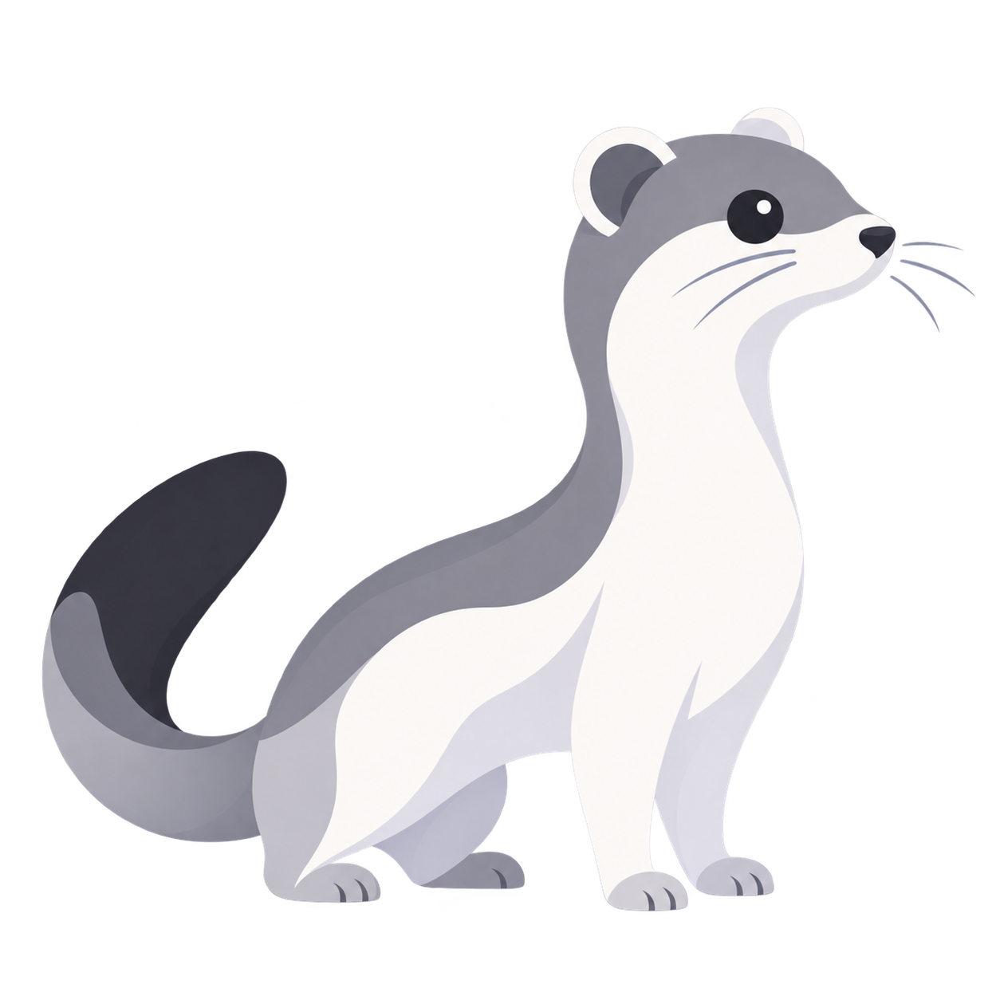

<div align="center">
  

  <h1 align="center">Stoat</h1>

  <p align="center">
    <strong>A self-hosted PaaS (Platform as a Service) built on top of <a href="https://uncloud.run/">Uncloud</a>.</strong>
  </p>

  <p align="center">
    
  </p>
</div>
<br/>


## Features

Stoat allows you to manage multiple [Uncloud](https://uncloud.run) clusters from a single dashboard.

- **Clusters** - Connect Uncloud clusters and manage every machine from one place.
- **Projects & Resources** - Group your services into projects and deploy them from Compose files.
- **Templates** - One-click deploys for common apps and databases.
- **Git** - Connect Forgejo, GitHub (incl. Enterprise) or any Git server via token, SSH or OAuth, then deploy and push Compose files straight from your repos.
- **Variables** - Per-resource environment variables.
- **Deployments** - Deployment history with live build/deploy logs.
- **Logs** - Live log tailing and historical search per resource.
- **Observability** - Cluster metrics and logs, powered by a monitoring stack (GreptimeDB + Alloy) Stoat deploys for you.
- **S3 Buckets** - Rustfs and Cloudflare R2 integration to create buckets and isolated access keys.
- **Multi Cluster** - You can use multiple uncloud clusters, each project gets its own clusters. (Multiple projects can still use the same cluster)
- **Organizations** - Multi-tenant.
- **Self-Hostable** - Your servers, your data.

## How it works

Stoat does not talk to your servers with ssh keys like similar apps. A small **sidecar** runs globally on every machine in your Uncloud cluster and exposes the Uncloud API over HTTP. The Stoat dashboard connects to that sidecar to deploy services, stream logs and run jobs such as resource deployments. Long-running work (initializing clusters, deploying resources) runs in a background worker backed by Postgres.

## Getting Started

### Prerequisites

- A Linux server you can SSH into as `root`, or as a user with passwordless sudo
- A domain with a DNS record pointing to that server

### Quick Install

Run this on your own computer:

```bash
curl -fsSL https://raw.githubusercontent.com/Stoat-Labs/Stoat/master/scripts/install.sh | bash
```

The script installs the Uncloud CLI if it's missing, sets up an [Uncloud](https://uncloud.run/) cluster on your server (or uses the one you already have), generates `.env` with random secrets and deploys Stoat with `uc deploy`. When it's done, open your domain and follow the setup wizard: the first account becomes the instance admin, then you name your organization and connect your cluster with the sidecar URL and token the script prints.

### Manual install

If you already have an [Uncloud](https://uncloud.run/) cluster and the Uncloud CLI, you can also set Stoat up by hand:

1. **Download `compose.yml` and `.env.example`**

    ```bash
    APP_URL=stoat.example.com
    APP_SECRET=changeme                   # openssl rand -hex 32 # this is used to encrypt secrets, dont lose it
    POSTGRES_PASSWORD=changeme            # openssl rand -hex 32
    SIDECAR_TOKEN=changeme                # openssl rand -hex 32 # please remember this one you'll need to use it when adding your cluster
    REDIS_URL=redis://stoat-cache.internal:6379
    APP_USE_INTERNAL_CACHE=false          # true adds a per-replica memory cache in front of Redis (single replica only)
    USE_INTERNAL_WORKER=true              # false only with the stoat-worker service in compose.yml enabled
    ```

2. **Start Stoat**

    ```bash
    uc deploy
    ```

3. Open `https://stoat.example` or whatever you set and follow the setup wizard: the first account becomes the instance admin, then you name your organization and connect your cluster (sidecar URL `http://sidecar.internal`, token is your `SIDECAR_TOKEN`). Enjoy :D

<!--## Project Structure

```bash
stoat/
├── apps/
│   ├── web/           # Dashboard + API (SvelteKit)
│   └── sidecar/       # Uncloud HTTP API, runs on every machine (Go)
├── packages/
│   ├── api/           # oRPC routers & business logic
│   ├── auth/          # Authentication configuration
│   ├── db/            # Database schema, queries & migrations (Drizzle)
│   ├── uncloud/       # TypeScript client for the sidecar
│   ├── workflows/     # Background jobs (cluster init, deployments)
│   └── config/        # Shared configuration
├── templates/         # One-click app templates
└── tests/             # TypeScript tests
```-->

## 📄 License

This project is licensed under the [Apache 2.0 License](LICENSE).

## Credits

Kudos to the contributors of [Coolify](https://coolify.io/) and [Dokploy](https://dokploy.com/), these 2 are the inspiration that Stoat is based on. Coolify's way of being more of a PaaS and Dokploy's of being closer to docker compose. The software Stoat uses [Uncloud](https://uncloud.run/). And Railway for letting me copy their ui lol, great platform if you dont want to manage your own infrastructure ♥️

## Sponsors

[](https://www.greptile.com/?utm_source=oss_badge&utm_medium=readme&utm_campaign=greptile_for_open_source)

## Screenshots


and there's more...

---

## Star History

<a href="https://www.star-history.com/#iRazvan2745/Stoat&Date">
 <picture>
   <source media="(prefers-color-scheme: dark)" srcset="https://api.star-history.com/svg?repos=iRazvan2745/Stoat&type=Date&theme=dark" />
   <source media="(prefers-color-scheme: light)" srcset="https://api.star-history.com/svg?repos=iRazvan2745/Stoat&type=Date" />
   
 </picture>
</a>

<div align="center">
  <sub>Built with ❤️ by irazz</sub>
</div>
